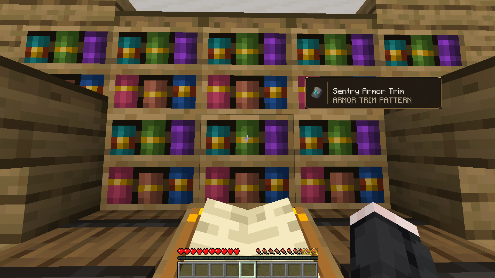

# Universal Chiseled Bookshelf

**Universal Chiseled Bookshelf** expands the vanilla Chiseled Bookshelf without adding new blocks or items. Turn your existing bookshelves into useful storage for books, armor trims, maps, navigation tools, banner patterns, music discs, and more while keeping Minecraft's original style.

  

## Features

- Store armor trim smithing templates and trimmed armor.
- Store books, enchanted books, and written books.
- Store filled maps and empty maps.
- Store paper and banner patterns.
- Store compasses, clocks, and recovery compasses.
- Store music discs.
- Uses the vanilla Chiseled Bookshelf and its six existing slots.
- Adds no new blocks or items.
- Optional preview HUD for the targeted bookshelf slot.
- Displays item names and enchantment levels.
- Toggle the preview through Mod Menu.
- Choose whether the preview appears on the left or right side.

## Vanilla-Friendly

The mod keeps the original Minecraft interaction, storage behavior, and visual style. It fits naturally in libraries, enchanting rooms, archives, cartographer rooms, and medieval builds.

## Installation

1. Install [Fabric Loader](https://fabricmc.net/use/installer/) for Minecraft 26.3.
2. Install [Fabric API](https://modrinth.com/mod/fabric-api).
3. Download the latest Universal Chiseled Bookshelf JAR from [Modrinth](https://modrinth.com/mod/universal-chiseled-bookshelf/releases).
4. Put the JAR files into your Minecraft `mods` folder.
5. Launch Minecraft with the Fabric profile.

## Configuration

Open the mod settings from Mod Menu to:

- Enable or disable the bookshelf preview.
- Move the preview to the left or right side of the screen.

## Requirements

- Minecraft Java Edition 26.3
- Fabric Loader 0.19.5 or newer
- Fabric API for Minecraft 26.3
- Java 25 or newer
- Mod Menu is optional and recommended for settings

## Links

- [Modrinth](https://modrinth.com/mod/universal-chiseled-bookshelf)
- [Issue Tracker](https://github.com/Dhityavv/universal-chiseled-bookshelf/issues)
- [Ko-fi](LINK_KO_FI_KAMU)
- [Saweria](LINK_SAWERIA_KAMU)

## Support

If you enjoy the mod, consider supporting development through Ko-fi or Saweria. Your support helps with maintenance, bug fixes, and future improvements.

## License

This project is released under the [CC0-1.0 License](https://creativecommons.org/publicdomain/zero/1.0/).

## Author

Made by **Dhityavv**.
